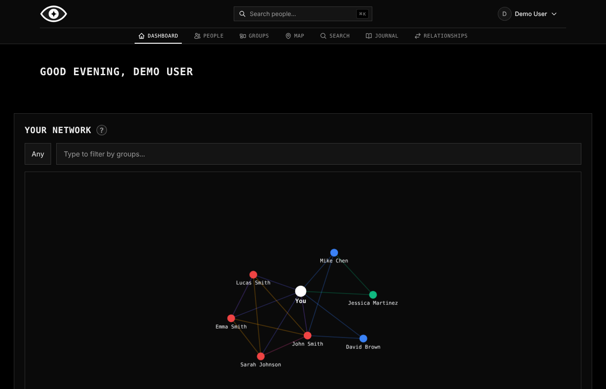
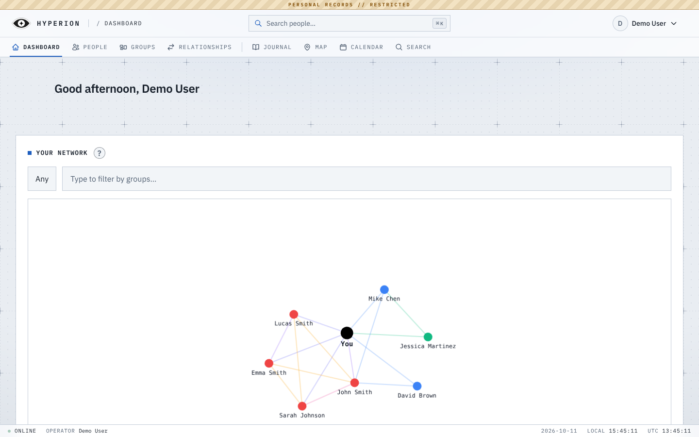
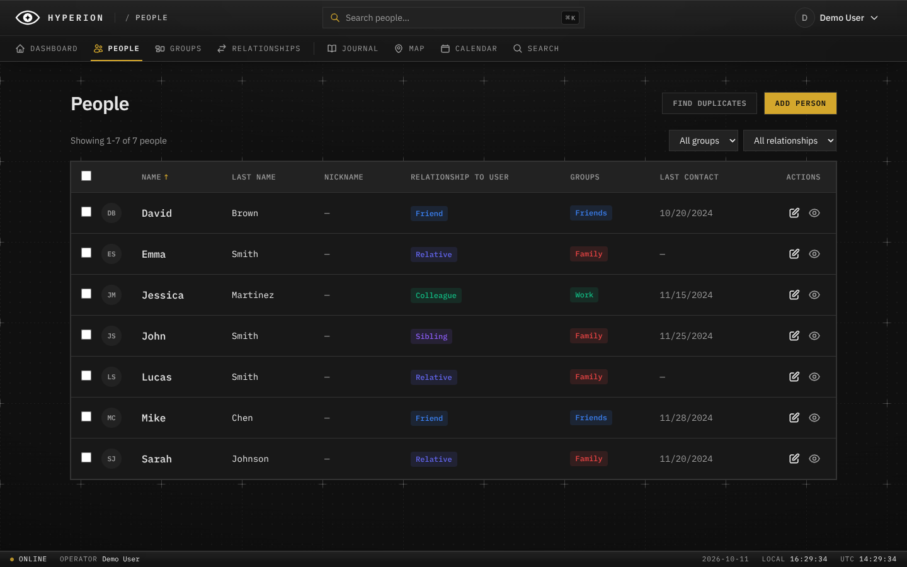
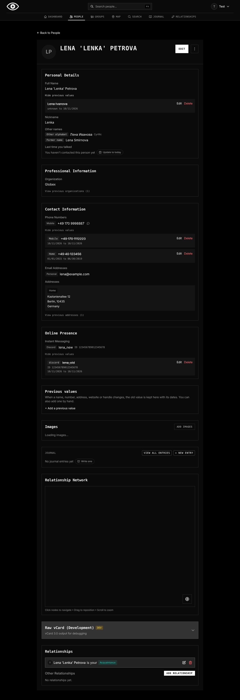
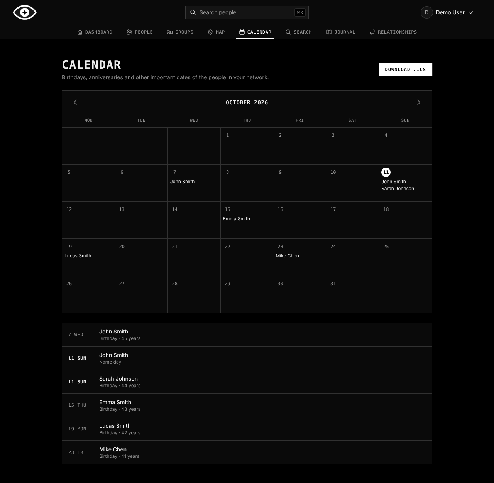
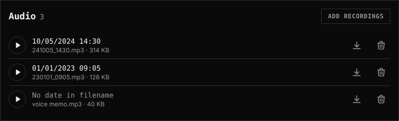

# hyperion

[](LICENSE)

hyperion is a self-hosted personal relationships manager. It keeps track of the people in your life, how they are connected, and the details worth remembering: birthdays, contact info, notes, places, documents and recordings.

It is a personal fork of [Nametag](https://github.com/mattogodoy/nametag) by Matto Godoy. It keeps everything Nametag does and adds the features listed below. Inside the app and in the docs folder the name "Nametag" still appears in places.



## What this fork adds

- **Advanced search**: a Search page with separate fields for name, location, email, phone and words in notes. Filters combine, match partially, and ignore case and accents. Phone search ignores formatting.
- **Admin-managed accounts**: the first account created on a fresh instance becomes the admin, and public signup closes after that. The admin adds, resets, promotes and deletes accounts in Settings > Users.
- **Single-person JSON export**: download one person's full profile as JSON from the person's menu, next to the existing whole-account export.
- **Document folder per person**: photos, PDFs, videos or any other file for each person, separate from the profile photo. Images get thumbnails, PDFs and videos open in the browser, and identical files are stored once.
- **Audio folder per person**: upload and play MP3 recordings. Files named `YYMMDD_HHMM.mp3` are dated automatically.
- **Handles and field history**: several messaging handles per platform with platform user IDs, other names (former names, other alphabets), and a history of old values (names, numbers, addresses, websites, handles) with editable dates.
- **Location history**: a list of places each person went, with a date and the reason for the trip. It is separate from addresses and included in JSON export, import and duplicate merges.
- **More custom field types**: date, link, multi-select and person (a link to another of your contacts). Date fields show up on the calendar and in the `.ics` file, and the people filter and advanced search understand all of them.
- **Calendar**: a month view of all important dates, with an `.ics` download for Google Calendar, Apple Calendar, Outlook or Thunderbird.
- **Trash retention you choose**: deleted items stay in the trash until you delete them by hand. Set `TRASH_RETENTION_DAYS` to a number of days to empty it automatically instead.
- **People list on phones**: one card per person instead of a table that scrolled sideways, with a sort picker and select-all.
- **Console-style UI**: a black-and-white theme with monospace labels and a new eye logo, in dark and light mode.
- **Map fix**: cluster counts on the map are readable in dark mode.
- **Android app**: a native app for your own server that runs without Google Play Services (GrapheneOS works). It lives in its own repository, [anvveber/hyperion_mobile](https://github.com/anvveber/hyperion_mobile), and the APK is on its [Releases page](https://github.com/anvveber/hyperion_mobile/releases).

## Screenshots

<details>
<summary>View screenshots</summary>


_Dashboard in the light theme_

---


_People list_

---


_A person with other names, previous values and handles_

---


_Calendar with .ics download_

---


_Audio folder on a person's page_

</details>

## Everything else (from Nametag)

- People with flexible fields: names, birthdays, important dates, photos and custom fields
- Relationships between people with custom relationship types, shown as interactive network graphs
- Groups, a journal, and a map of geocoded addresses
- Reminders for important dates and for staying in touch, sent by email, web push, ntfy or webhooks
- CardDAV sync with Google Contacts, iCloud, Outlook and Nextcloud
- vCard and JSON import and export
- Duplicate detection and merging, bulk actions, and a trash with restore
- Quick search with `Ctrl+K` / `Cmd+K` that tolerates typos
- REST API with OpenAPI documentation and token authentication
- OIDC / SSO login
- Installable as a PWA, works on phones
- Dark and light themes
- Languages: English, Spanish, German, French, Italian, Dutch, Norwegian, Russian, Japanese and Chinese

## Running it

hyperion has no published Docker image, so you build it from this repository. You need Docker with the compose plugin.

```bash
git clone https://github.com/anvveber/hyperion.git
cd hyperion
docker build -t hyperion .
```

Then:

1. Copy `.env.example` to `.env` and fill it in (database password, `NEXTAUTH_SECRET`, `CRON_SECRET`, `REDIS_PASSWORD` and so on).
2. In `docker-compose.yml`, change the app's `image:` line to `image: hyperion`.
3. The compose file expects two Docker networks to exist already. Create them once, then start everything:

```bash
docker network create nametag-network
docker network create proxy
docker compose up -d
```

Open `http://localhost:3000`. The first account you create becomes the admin. Database migrations run automatically when the container starts.

To update later, run `git pull`, build the image again, and run `docker compose up -d`.

Documentation for configuration, email, OIDC, Redis, reverse proxies, backups and every feature is in [`docs/src/content/docs/`](docs/src/content/docs/).

## Development

See [CONTRIBUTING.md](CONTRIBUTING.md) and the [development guide](docs/src/content/docs/contributing/development.md) for running hyperion locally.

## License

Licensed under the [GNU Affero General Public License v3.0](LICENSE), like Nametag. If you modify and deploy it, you must make your source code available.
